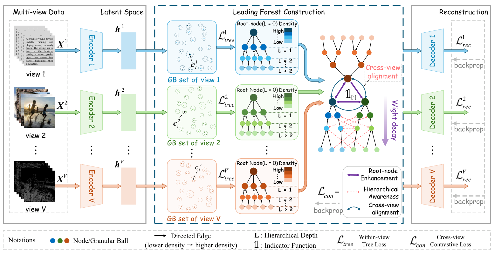
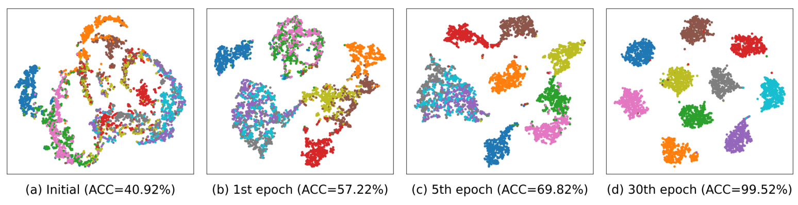

# GBPOT

Code and experimental results for **Partial Order Topology Helps in Multi-view Contrastive Clustering with Granular-ball**.

GBPOT is a multi-view contrastive clustering method that combines granular-ball representations with a density-guided partial-order topology. It organizes within-view associations using leading forests and uses hierarchical depth to weight cross-view alignment.

## Overview

The framework consists of four components:

1. View-specific autoencoders learn latent representations and reconstruct the input features.
2. Granular balls summarize local structure in each view.
3. Density-guided leading forests define within-view parent-child associations.
4. Layer-aware weighting and root-node enhancement guide cross-view contrastive alignment.

After training, the representations are averaged across views and clustered with k-means.



## Datasets

| Dataset | Samples | Clusters | Views | Feature dimensions |
| --- | ---: | ---: | ---: | --- |
| BBCSport | 544 | 5 | 2 | 3183 / 3203 |
| Caltech101-20 | 2,386 | 20 | 2 | 1984 / 512 |
| Cora | 2,708 | 7 | 2 | 2708 / 1433 |
| Scene-15 | 4,485 | 15 | 3 | 20 / 59 / 40 |
| MNIST-USPS | 5,000 | 10 | 2 | 784 / 784 |
| ALOI-100 | 10,800 | 100 | 4 | 77 / 13 / 64 / 125 |
| NoisyMNIST | 50,000 | 10 | 2 | 784 / 784 |

Dataset statistics are from Table II of the manuscript. The CSV files below contain reported experimental results, not the benchmark datasets.

## Clustering results

GBPOT results from Table III of the manuscript are listed below. ACC, NMI, and PUR are reported in percent; higher values indicate better performance.

| Dataset | ACC (%) | NMI (%) | PUR (%) |
| --- | ---: | ---: | ---: |
| BBCSport | 96.32 | 89.18 | 96.32 |
| Caltech101-20 | 79.00 | 72.94 | 81.60 |
| Cora | 68.72 | 47.72 | 69.76 |
| Scene-15 | 43.52 | 43.65 | 47.09 |
| MNIST-USPS | 99.80 | 99.37 | 99.80 |
| ALOI-100 | 90.94 | 95.83 | 91.64 |
| NoisyMNIST | 99.60 | 98.66 | 99.60 |

The reported ACC improvement over MGBCC averages 1.98 percentage points across the seven datasets. GBPOT has higher ACC on six datasets and slightly lower ACC on Scene-15 (43.52% versus 43.72%).

- [GBPOT results](results/gbpot_results.csv)
- [Full comparison from Table III](results/table3_all_results.csv)
- [Dataset statistics](results/datasets.csv)

These values are transcribed from the manuscript, not newly reproduced runs. As stated in the manuscript, comparison-method results were taken from the MGBCC paper. `NA` in the full comparison denotes an unavailable result reported as out-of-memory.

## Ablation study

Results on Caltech101-20 from Table V. HA denotes Hierarchical Awareness, and RE denotes Root-node Enhancement.

| Configuration | ACC (%) | NMI (%) | PUR (%) |
| --- | ---: | ---: | ---: |
| Baseline | 72.63 | 71.57 | **81.89** |
| Baseline + tree loss | 74.48 | 71.72 | 79.21 |
| Baseline + tree loss + HA | 77.86 | 72.84 | 80.06 |
| Baseline + tree loss + HA + RE | **79.00** | **72.94** | 81.60 |

The full configuration gives the highest ACC and NMI in this ablation; the baseline has the highest PUR.

[Download ablation results](results/ablation_caltech101_20.csv)

## Visualization

The following t-SNE visualization shows the evolution of learned representations on MNIST-USPS (Fig. 3 of the manuscript).



The ACC values shown in this visualization belong to the illustrated training run. Its final displayed ACC is 99.52%; the main comparison table reports 99.80%.

## Experimental setup reported in the manuscript

- Framework: PyTorch 2.0.1.
- Hardware: one NVIDIA RTX 4060 GPU.
- Optimizer: Adam, learning rate 0.01, weight decay 0.
- Batch size: 256 or 512, depending on the dataset.
- Hierarchical sensitivity and root-node enhancement weight: both 0.5.
- Reconstruction loss weight: generally 1; tree loss weight: 0.06.
- Default encoder widths: input dimension, 2000, 500, 500, latent dimension, with a symmetric decoder.
- BBCSport uses a single-layer linear encoder; Cora omits ReLU activations.

These settings summarize the manuscript. The supplied JSON files are not the complete configurations for reproducing all reported experiments. For example, the Caltech101-20 configuration uses batch size 128 and reconstruction weight 10.

## Installation

The original code documents Python 3.9 and PyTorch 2.0.1. Suggested dependencies for training are:

```bash
conda create -n gbpot python=3.9 -y
conda activate gbpot
pip install torch==2.0.1 --index-url https://download.pytorch.org/whl/cu118
pip install numpy==1.23.0 scipy==1.9.1 scikit-learn==1.2.2 torchsummary==1.5.1 hdf5storage==0.1.19 tqdm
```

The CUDA wheel requires a compatible NVIDIA driver. Plotting utilities additionally use `matplotlib` and `pandas`. These installation commands have not been validated in a fresh environment.

```bash
git clone https://github.com/Zhi-ouZhou/GBPOT.git
cd GBPOT/GBPOT
```

## Data preparation

Benchmark datasets are not included. The loader expects MATLAB files with `data` (a cell array of view matrices, each with samples in rows) and `labels` (one label per sample). It accesses each view using `data[v][0]`, so the cell array should have shape `(number_of_views, 1)`.

Edit `config/granular_config/global.json` to set `src` to your dataset root. The file path is `<src>/<parent>/<dataset>.mat`, where `parent` comes from the dataset-specific JSON. With the supplied Caltech101-20 settings, this is:

```text
data/smalldata/Caltech101-20.mat
```

Caltech101-20 selects views `[3, 4]` using zero-based indexing and expects the original multi-view file. A file containing only the two selected views requires corresponding changes to `select_views` and the architecture configuration. The supplied granular configuration directory contains only `global.json` and `Caltech101-20.json`; other datasets require their own configurations.

## Running a single configuration

The supplied `main.py` has an unfinished parameter-search entry point with undefined search variables. To run a single configuration, call the existing training function directly from the code directory:

```bash
python -c "from argparse import Namespace; from main import run_on_setting; run_on_setting(Namespace(dataset='Caltech101-20', global_config='./config/granular_config/global.json'))"
```

This prints per-epoch losses and ACC/NMI/PUR without writing the parameter-search result file. It has not been run end to end here because the benchmark data are not included.

Configuration precedence is function keyword overrides, dataset JSON, then global JSON. Relevant fields include:

- `p`: granular-ball partition parameter.
- `latent_dim`, `batch_size`, `epochs`: representation and training settings.
- `loss_weights[0]` and `loss_weights[1]`: contrastive and reconstruction coefficients.
- `tree_loss_weight`: tree-loss coefficient; the training function defaults to 0.1 when absent.
- `start_dual_prediction`: warm-up epochs before tree construction, default 20.
- `select_views`: zero-based view indices.

The paper reports a tree-loss coefficient of 0.06. Set `"tree_loss_weight": 0.06` in the dataset configuration or pass `tree_loss_weight=0.06` to `run_on_setting` to select that value. Changing this value alone does not guarantee reproduction of the paper's results.

## Repository structure

```text
README.md                 Overview, results, and usage
assets/                   Framework and t-SNE figures
results/                  Reported results in CSV format
GBPOT/
  main.py                 Training function and parameter-search code
  leading_tree.py         Leading-tree construction
  config/                 Training configurations
  granular/               Granular-ball construction and objectives
  model/                  Autoencoders and contrastive objectives
  utils/                  Data loading and evaluation
  paper_reimpl/           Additional baseline implementation files
```

## Acknowledgment

This work builds on granular-ball contrastive clustering and leading-tree methods. We acknowledge MGBCC:

P. Su, S. Huang, W. Ma, D. Xiong, and J. Lv, “Multi-view granular-ball contrastive clustering,” Proceedings of the AAAI Conference on Artificial Intelligence, vol. 39, pp. 20637-20645, 2025.
